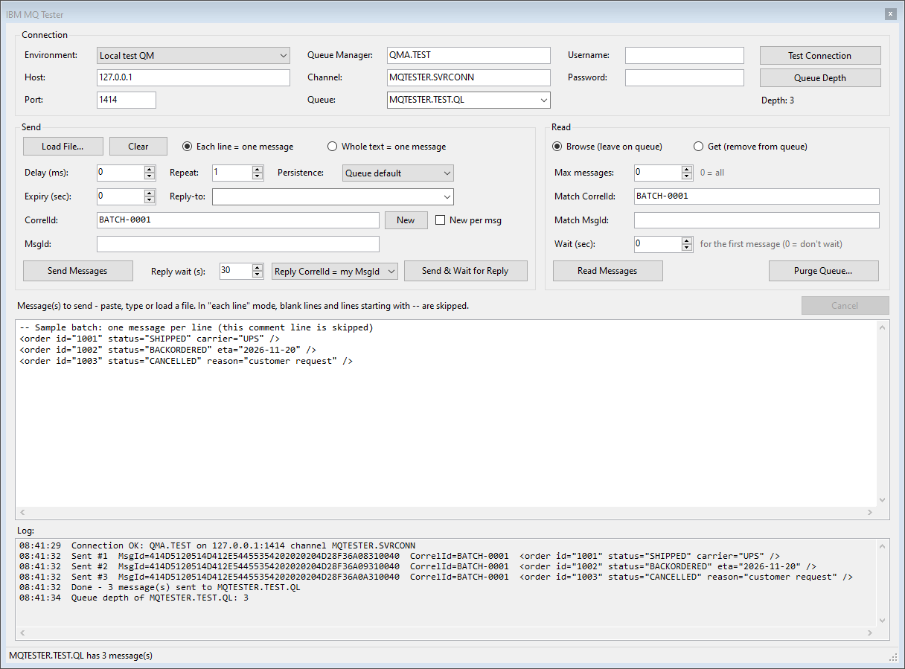
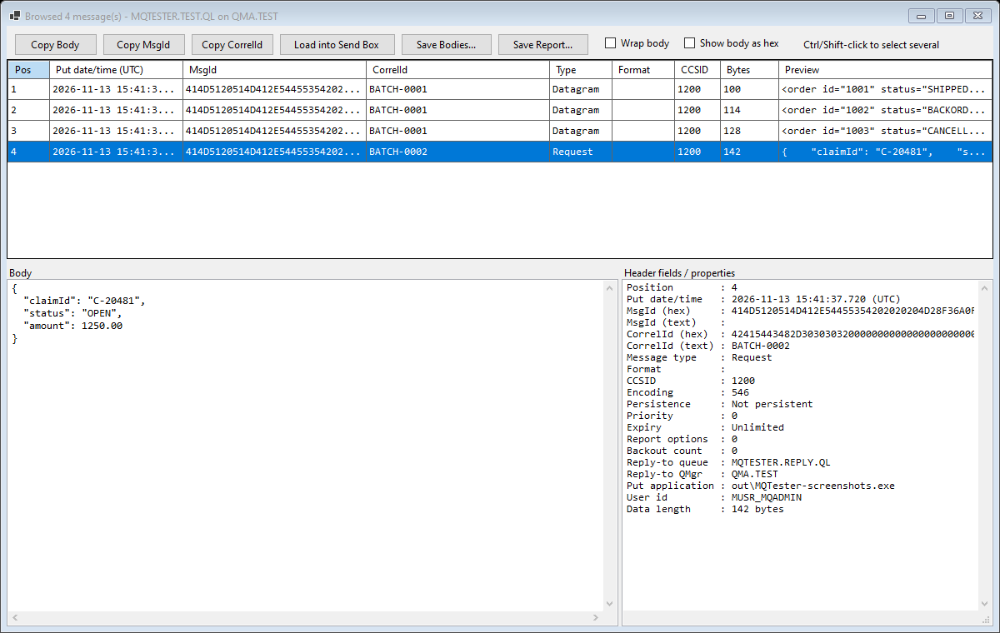

# MQTester

A small Windows desktop tool for testing **IBM MQ** queues: send messages, browse or get them, work with correlation IDs, and test request/reply, without writing any code.



## Features

- **Send** messages that you type, paste or load from a file: one message per line, or the whole text as one message
- **Browse** (peek) or **get** (remove) messages, and view them with every MQ header field in a separate viewer window
- **Correlation IDs and message IDs:** set them on sent messages, or read only the messages that match
- **Request/reply testing:** send a request with a reply-to queue, then wait for the reply with the matching correlation ID
- **Environment profiles** in `appsettings.json`, so you pick a queue manager from a dropdown instead of retyping connection details
- **Repeat, delay, persistence and expiry** options for load and behaviour testing
- **Queue depth** and **purge**
- **Responsive while working:** MQ work runs in the background, with a progress bar, a Cancel button and a log panel (also written to a file)



## Requirements

- Windows 10 or 11
- [.NET 8 SDK](https://dotnet.microsoft.com/download/dotnet/8.0) to build (or the .NET 8 Desktop Runtime to run a framework-dependent build)
- Network access to an IBM MQ queue manager with a server-connection (SVRCONN) channel. No IBM MQ client install is needed, because the app uses IBM's managed .NET client from NuGet (`IBMMQDotnetClient`).

## Quick start

```bash
git clone https://github.com/DFranke84/MQTester.git
cd MQTester
dotnet build MQTester.sln -c Release
```

Run `MQTester\bin\Release\net8.0-windows\MQTester.exe`. On first run it creates `appsettings.json` from `appsettings.example.json` and tells you where the file is. Edit it to add your queue managers, then restart the app (see [section 3](#3-setting-up-environments-appsettingsjson)).

Don't have a queue manager to test against? See [section 14](#14-setting-up-a-local-test-queue-manager).

To build a single self-contained `.exe` that runs without .NET installed, use the included publish profile:

```bash
dotnet publish MQTester/MQTester.csproj -p:PublishProfile=FolderProfile
```

The output goes to `MQTester\bin\Release\net8.0-windows\publish\win-x64\`. Copy `appsettings.json` (or `appsettings.example.json`) next to the published `.exe`.

---

# User guide

## Contents

1. [Starting the app](#1-starting-the-app)
2. [The screen at a glance](#2-the-screen-at-a-glance)
3. [Setting up environments (appsettings.json)](#3-setting-up-environments-appsettingsjson)
4. [Connecting](#4-connecting)
5. [Sending messages](#5-sending-messages)
6. [Message IDs and correlation IDs](#6-message-ids-and-correlation-ids)
7. [Reading messages](#7-reading-messages)
8. [The message viewer window](#8-the-message-viewer-window)
9. [Reply-to and Send & Wait for Reply](#9-reply-to-and-send--wait-for-reply)
10. [Queue depth and purge](#10-queue-depth-and-purge)
11. [Log, status bar and Cancel](#11-log-status-bar-and-cancel)
12. [Remembered settings](#12-remembered-settings)
13. [Common MQ errors](#13-common-mq-errors)
14. [Setting up a local test queue manager](#14-setting-up-a-local-test-queue-manager)
15. [Safety tips](#15-safety-tips)
16. [For developers](#16-for-developers)

---

## 1. Starting the app

Run `MQTester.exe` from the build or publish folder, for example
`MQTester\bin\Debug\net8.0-windows\MQTester.exe`.

The app reads `appsettings.json` from **the same folder as the .exe**, wherever you start it from. If the file isn't there, it is created from `appsettings.example.json` on first run. If you keep a copy in the project folder, each build copies it over; otherwise edit the copy next to the `.exe`.

---

## 2. The screen at a glance

| Area | What it's for |
|---|---|
| **Connection** (top) | Pick an environment, check or override the connection details, Test Connection, Queue Depth |
| **Send** (middle left) | Load File, Clear, send mode, send options, IDs, Send Messages, Send & Wait for Reply |
| **Read** (middle right) | Browse or Get, max messages, match by ID, wait time, Read Messages, Purge Queue |
| **Message box** (large text area) | The message(s) to send. Type, paste or load a file. |
| **Cancel** (above the message box, right) | Stops whatever MQ operation is running |
| **Log** (bottom) | Timestamped record of everything sent, read and failed |
| **Status bar** (very bottom) | Current activity and a progress bar |

Hover over most fields to see a tooltip explaining them.

---

## 3. Setting up environments (appsettings.json)

### Two files

| File | Where | In git? |
|---|---|---|
| `appsettings.example.json` | Project folder, copied next to the `.exe` | **Yes.** Placeholders only. |
| `appsettings.json` | Next to `MQTester.exe` (and optionally the project folder) | **No.** Git-ignored. Holds your real servers and passwords. |

On first run, if there is no `appsettings.json`, the app copies the example to `appsettings.json` and tells you where it is.

If you keep your own `appsettings.json` in the project folder (`MQTester\appsettings.json`), every build copies it to the output folder. It stays out of git.

### Environments

The **Environment** dropdown is filled from the `MQEnvironments` list. When you pick an environment, it fills in Host, Port, Channel, Queue Manager, Username and Password, plus the **Queue** and **Reply-to** dropdown lists.

```jsonc
"MQEnvironments": [
  {
    "Name": "Example - TEST server",  // what shows in the dropdown
    "Host": "mq-test.example.com",
    "Port": 1414,
    "Channel": "APP.SVRCONN",
    "QueueManager": "QM.TEST",
    "Queues": [ "APP.REQUEST.QL", "APP.REPLY.QL" ], // first one is selected by default
    "UseDefaultCredentials": true     // use MQDefaultCredentials below
  },
  {
    "Name": "Local developer QM (QM1)",
    "Host": "127.0.0.1",
    "Port": 1414,
    "Channel": "DEV.APP.SVRCONN",
    "QueueManager": "QM1",
    "Queues": [ "DEV.QUEUE.1", "DEV.QUEUE.2", "DEV.QUEUE.3" ],
    "UseDefaultCredentials": false,   // use this entry's own login
    "Username": "app",                // blank = no username/password sent
    "Password": ""
  }
],

"MQDefaultCredentials": {
  "Username": "your-mq-user",
  "Password": ""
}
```

**To add an environment:** copy an entry, change the values, save the file and restart the app.

**To add queues:** list them in `Queues`. Every queue listed there also appears in the **Reply-to** dropdown.

**Credentials:**
- `"UseDefaultCredentials": true` uses the shared `MQDefaultCredentials` login, so the password is stored only once.
- `"UseDefaultCredentials": false` uses the entry's own `Username` and `Password`.
- A blank username means no login is sent at all, which suits a local test server.

> ⚠️ Passwords in `appsettings.json` are stored as plain text. Anyone who can read the file can see them.

**Old format:** if `MQEnvironments` is missing, the app still reads the old single `MQSettings` section and shows it as one environment.

**Overriding values:** every connection field stays editable, so you can type a one-off host, port, queue and so on without changing the config. Typed values are used until you pick another environment.

---

## 4. Connecting

The app does not hold a connection open. Each action (send, read, depth, purge, test) connects, does its job and disconnects. Every action therefore uses whatever is in the connection fields at that moment.

| Button | What it does |
|---|---|
| **Test Connection** | Connects to the queue manager and disconnects. A success line appears in the log and the status bar. |
| **Queue Depth** | Shows how many messages are on the selected queue, as "Depth: n" |

### "Can't run yet" popups

All buttons stay enabled. If you click one before everything it needs is filled in, **one popup lists every reason** it can't run yet. Examples:
- Host, Port, Channel, Queue Manager or Queue is blank
- the port isn't a number from 1 to 65535
- the message box is empty
- Send & Wait has no Reply-to queue, or has more than one message to send
- an ID field is too long

Fix the items listed and click again. If connection fields are missing, the popup reminds you that picking an Environment fills them in.

---

## 5. Sending messages

### Getting a message into the box

You can do any of these:
- type it
- paste it
- click **Load File...** to load a text file (`.txt`, `.xml`, `.json`, `.csv` or any file)

You **don't** need to load a file to send. Whatever is in the message box is what gets sent. **Clear** empties the box.

### Send mode

| Mode | Behaviour |
|---|---|
| **Each line = one message** | Every line becomes a separate message. Blank lines are skipped, and lines starting with `--` are treated as comments and skipped. |
| **Whole text = one message** | The entire box is sent as a single message, line breaks included. Use this for XML or JSON that spans several lines. |

Example in "each line" mode. This file sends **2** messages:

```
-- test batch for ticket 1234
ORDER|1001|SHIPPED

ORDER|1002|CANCELLED
```

### Send options

| Option | Meaning |
|---|---|
| **Delay (ms)** | Pause between messages (0 to 600,000 ms). Handy for not flooding a consumer. |
| **Repeat** | Sends the whole set this many times (1 to 100,000), for load testing. Three lines with Repeat 10 sends 30 messages. |
| **Persistence** | *Queue default* (uses the queue's setting), *Persistent* (survives a queue manager restart) or *Not persistent* |
| **Expiry (sec)** | The message disappears from the queue if nobody reads it within this many seconds. 0 means it never expires. |
| **Reply-to** | Names the queue the receiving app should answer to. See [section 9](#9-reply-to-and-send--wait-for-reply). Leave it blank for normal one-way messages. |
| **CorrelId / New / New per msg** | Correlation ID to put on the messages. See [section 6](#6-message-ids-and-correlation-ids). |
| **MsgId** | A message ID to use. Leave it blank (normal) and the queue manager creates a unique one. |

Click **Send Messages**. The progress bar and status bar count the messages as they go, and each one is logged with its MsgId and CorrelId. For runs over 200 messages, the log shows every 100th line so it stays readable.

**Message encoding:** text is sent with the IBM MQ .NET client's default, UTF-16 (CCSID 1200), with a blank format field. Receiving apps that use MQ's get-with-convert option see it in their own code page.

---

## 6. Message IDs and correlation IDs

Every MQ message carries two 24-byte IDs:

| ID | What it is | Who sets it |
|---|---|---|
| **MsgId** (message ID) | Unique ID of this one message | Normally the queue manager. MQTester shows it in the log after each send. |
| **CorrelId** (correlation ID) | A "this belongs with that" tag that links related messages, e.g. a reply to its request, or all messages in one batch | Whoever sends the message. Blank by default. |

### How to type an ID

In any ID field (CorrelId, MsgId, Match CorrelId, Match MsgId) you can enter:

- **Text**, up to 24 characters, e.g. `ORDER-123`. It is padded with zero bytes to 24 bytes.
- **Hex**, exactly 48 hex characters, e.g. `414D5120514D412E54455354202020204D28F36A022D0040`. It is used as the raw bytes.
- **Nothing**, meaning no ID.

Anything longer than 24 characters that isn't 48 hex characters is rejected with a message.

### Options when sending

- **CorrelId field:** every message in the send gets this CorrelId. That's useful for tagging a batch so you can find it again later with *Match CorrelId*.
- **New button:** fills in a random CorrelId (48 hex characters).
- **New per msg:** every message gets its own random CorrelId. This overrides the CorrelId field. If you've also typed a CorrelId, the app warns you that it will be ignored and asks whether to send anyway.
- **MsgId field:** forces a specific MsgId. If you send more than one message with a fixed MsgId, the app warns you that they will all share it.

### How IDs are shown

In the log and the viewer list, an ID that is readable text shows as text (e.g. `ORDER-123`); otherwise it shows as hex. The viewer's detail pane always shows both.

---

## 7. Reading messages

### Browse or Get

| Mode | Effect |
|---|---|
| **Browse (leave on queue)** | Looks at the messages without removing them. Safe, and the default. |
| **Get (remove from queue)** | Takes the messages off the queue. They are gone from MQ once read. |

### Read options

| Option | Meaning |
|---|---|
| **Max messages** | How many to read, starting from the front of the queue. **0 = all.** With Get mode and 0, the app asks you to confirm first. |
| **Match CorrelId** | Only read messages with this correlation ID |
| **Match MsgId** | Only read the message with this message ID |
| **Wait (sec)** | If no matching message is there yet, wait up to this long for the first one to arrive. 0 means don't wait. After the first message, reading stops as soon as no more are available. |

You can fill in both match fields; a message then has to match both.

Click **Read Messages**. The log says how many were read. If any were found, the viewer window opens.

**Examples:**
- See what's on a queue without disturbing it: Browse, Max 10, no matching.
- Find the batch you tagged `TEST-RUN-5`: Browse, Max 0, Match CorrelId `TEST-RUN-5`.
- Remove one specific message: Get, Match MsgId = its hex MsgId (copy it from the log or the viewer).
- Wait for a message that's about to be sent by another system: Browse, Wait 60.

---

## 8. The message viewer window

Each read opens its own viewer window, so you can keep several open and compare them.

**Message list (top)**, one row per message:

| Column | Meaning |
|---|---|
| Pos | Position in the result (1 = first read) |
| Put date/time (UTC) | When the message was put on the queue, in UTC |
| MsgId / CorrelId | Shown as text if readable, otherwise hex |
| Type | Datagram (one-way), Request, Reply or Report |
| Format | MQ format name (e.g. `MQSTR`), blank if none |
| CCSID | Character set of the message body |
| Bytes | Size of the body |
| Preview | First 300 characters of the body, on one line |

**Body (bottom left):** the full text of the selected message.
- **Wrap body** turns word-wrap on or off.
- **Show body as hex** shows a hex dump of the raw bytes, which is useful for odd characters or binary data.

**Header fields / properties (bottom right):** every MQ header field, including:
- MsgId and CorrelId (hex and text)
- type, format, CCSID, encoding
- persistence, priority, expiry, report options, backout count
- reply-to queue and queue manager
- put application and user ID
- any message properties (MQRFH2)

**Toolbar buttons** (Ctrl-click or Shift-click selects several rows):

| Button | What it does |
|---|---|
| **Copy Body** | Copies the bodies of the selected messages, one per line |
| **Copy MsgId / Copy CorrelId** | Copies the current message's ID as hex, ready to paste into a Match field |
| **Load into Send Box** | Puts the selected bodies into the main message box so you can resend them. One multi-line message switches to "whole text" mode; several single-line messages load one per line. |
| **Save Bodies...** | Saves the bodies of the selected messages, or all of them if none are selected, one per line. The file can be loaded back with Load File. |
| **Save Report...** | Saves a full text report (all header fields plus body) of the selected messages, or all of them |

If a button has nothing to work on (no row selected, an empty body, or a message with no CorrelId), a popup says so instead of silently doing nothing.

---

## 9. Reply-to and Send & Wait for Reply

### The idea

A **Reply-to queue** is a note on your message telling the receiving program where to send its answer. MQ itself never sends replies. The program that reads your message has to:

1. read the Reply-to queue name from your message,
2. send its answer to that queue, and
3. **put a CorrelId on the answer** that links it back to your request.

If the other program doesn't do step 3, nothing can tell which reply belongs to which request, and **Send & Wait for Reply will time out** even if a reply shows up.

### Reply-to with Send Messages

If you fill in **Reply-to** and click **Send Messages**, each message:
- is marked as a **Request** message,
- carries the Reply-to queue name.

The app does **not** wait for anything. This is useful when the other system answers later and you'll check the reply queue yourself.

### Send & Wait for Reply

1. Put **one** message in the box: whole-text mode, or a single line.
2. Choose the **Reply-to** queue. It must exist on the same queue manager.
3. Set **Reply wait (s)**: how long to wait, 1 to 3600 seconds.
4. Choose how the responder links its reply (see below).
5. Click **Send & Wait for Reply**.

The app opens the reply queue, sends the request, then waits for a message on the reply queue with the matching CorrelId:
- **A match arrives:** it is **taken off** the reply queue and shown in a viewer window.
- **Replies with other CorrelIds:** left alone.
- **Nothing in time:** the log shows `No reply within N sec`.

### Which CorrelId to expect: the "Reply CorrelId =" dropdown

There are two common conventions, and the receiving app decides which one it follows:

| Setting | What the responder does | Notes |
|---|---|---|
| **Reply CorrelId = my MsgId** (default) | Copies your request's **MsgId** into the reply's CorrelId | The standard MQ convention; most apps do this |
| **Reply CorrelId = my CorrelId** | Copies your request's **CorrelId** into the reply unchanged | "Pass-through" style. If you left CorrelId blank, MQTester generates one so there is something to match on. |

MQTester also sets the matching MQ *report option* on the request (`MQRO_COPY_MSG_ID_TO_CORREL_ID` or `MQRO_PASS_CORREL_ID`) to tell the responder which style you expect. Whether the responder honours it is up to that app's code; many always use one fixed style.

### Not sure what the other app does?

1. Send a request with Reply-to set, using either Send button.
2. Note the request's **MsgId** and **CorrelId** in the log.
3. **Browse** the reply queue with Read Messages and look at the reply's **CorrelId** in the viewer.
4. Compare:
   - It matches your **MsgId**: use "= my MsgId".
   - It matches your **CorrelId**: use "= my CorrelId".
   - It matches neither: the app doesn't correlate its replies. Send & Wait can't work with it, but you can still read its replies with Read Messages.

> On the local test server nothing is listening, so Send & Wait will always time out there. That's expected.

---

## 10. Queue depth and purge

- **Queue Depth** shows the current number of messages on the selected queue.
- **Purge Queue...** removes **every** message from the selected queue. It first asks you to confirm, showing the queue, queue manager, host and port. **This cannot be undone.** The log records how many messages were removed.

---

## 11. Log, status bar and Cancel

- **Log panel:** every send, read, depth check, purge and error, with the time. MsgIds and CorrelIds are logged, so you can copy them from here into the Match fields.
- **Log file:** the same activity, with full error details, is written to `logs\logfile.txt` in the app folder, controlled by the `NLog` section of `appsettings.json`.
- **Errors:** shown in a popup and in the log. Common MQ reason codes get a plain-English hint (see [section 13](#13-common-mq-errors)).
- **Status bar:** what's happening now, plus a progress bar while working.
- **Cancel:** stops the current send, read, wait or purge. Messages already sent or removed stay sent or removed. Waits stop within about a second.

All MQ work runs in the background, so the window stays usable while it runs. The action buttons are disabled until the current job finishes or is cancelled.

---

## 12. Remembered settings

When you close the app, it remembers:
- the environment and queue
- the Reply-to queue
- the send mode and send options
- the reply wait and match style
- browse/get, max messages and the read wait

They're saved in `%LOCALAPPDATA%\MQTester\userprefs.json`, separately for each Windows user. Connection details and passwords are **not** saved there; they always come from `appsettings.json` or what you type. Delete that file to go back to the defaults.

---

## 13. Common MQ errors

| Code | Meaning | What to check |
|---|---|---|
| 2009 | Connection broken | Network or queue manager restarted; try again |
| 2016 | Gets inhibited | The queue is set to refuse reads |
| 2033 | No message available | Nothing matched (normally handled quietly) |
| 2035 | Not authorized | Username/password, channel authentication (CHLAUTH) rules, queue permissions |
| 2051 | Puts inhibited | The queue is set to refuse new messages |
| 2053 | Queue full | The queue hit its maximum depth |
| 2058 | Queue manager name error | The queue manager name doesn't match the one on that host and port |
| 2059 | Queue manager not available | Host, port, channel; is the listener running? |
| 2085 | Unknown object name | Queue name typo, or the queue isn't on that queue manager |
| 2538 | Host not available | Host name or port wrong, or a firewall is blocking |
| 2540 | Unknown channel name | Channel name typo (it's case-sensitive) |

For 2035, the queue manager's error log (`AMQERR01.LOG`) usually says exactly why.

---

## 14. Setting up a local test queue manager

Never practise on a shared queue manager. Two ways to get your own:

### Option A: IBM MQ developer container (easiest)

With Docker or Podman installed:

```bash
docker run --name mq -d -p 1414:1414 -p 9443:9443 -e LICENSE=accept -e MQ_QMGR_NAME=QM1 -e MQ_APP_PASSWORD=<choose-a-password> -e MQ_ADMIN_PASSWORD=<choose-a-password> icr.io/ibm-messaging/mq:latest
```

This gives you queue manager `QM1` on port 1414, with:
- channel `DEV.APP.SVRCONN`
- queues `DEV.QUEUE.1` to `DEV.QUEUE.3`
- user `app`

That matches the **Local developer QM (QM1)** entry in `appsettings.example.json`. Put the app password in that entry's `Password`. The container image is for development use under IBM's developer licence.

### Option B: IBM MQ installed on Windows

If IBM MQ Server is installed locally (e.g. the free IBM MQ Advanced for Developers), create test objects on a **test** queue manager. Replace `YOUR.TEST.QM` with its name and 1414 with its listener port.

```bat
cd "C:\Program Files\IBM\MQ\bin"
runmqsc YOUR.TEST.QM
```

```
DEFINE QLOCAL('MQTESTER.TEST.QL')  DESCR('MQTester test queue')  MAXDEPTH(100000)
DEFINE QLOCAL('MQTESTER.REPLY.QL') DESCR('MQTester reply queue') MAXDEPTH(100000)
DEFINE CHANNEL('MQTESTER.SVRCONN') CHLTYPE(SVRCONN) TRPTYPE(TCP) DESCR('MQTester local test channel')
SET CHLAUTH('MQTESTER.SVRCONN') TYPE(ADDRESSMAP) ADDRESS('127.0.0.1') USERSRC(MAP) MCAUSER('MUSR_MQADMIN') ACTION(ADD)
SET CHLAUTH('MQTESTER.SVRCONN') TYPE(BLOCKUSER) USERLIST('nobody') ACTION(ADD)
END
```

What those last two rules do:
- Only connections from **127.0.0.1** may use the channel, and they run as the local MQ admin account.
- The second rule lifts the default "block admin users" rule, **for this channel only**.

**If you still get 2035:** the queue manager's default `CHCKCLNT(REQDADM)` setting wants a password for admin-level identities. Either connect with a username and password, or, on a test-only queue manager where nothing else accepts client connections, relax it:

```
ALTER AUTHINFO('SYSTEM.DEFAULT.AUTHINFO.IDPWOS') AUTHTYPE(IDPWOS) CHCKCLNT(OPTIONAL)
REFRESH SECURITY TYPE(CONNAUTH)
```

Then add an environment to `appsettings.json`:

```jsonc
{
  "Name": "Local test QM",
  "Host": "127.0.0.1",     // not "localhost" - that may connect over IPv6 and miss the 127.0.0.1 rule
  "Port": 1414,
  "Channel": "MQTESTER.SVRCONN",
  "QueueManager": "YOUR.TEST.QM",
  "Queues": [ "MQTESTER.TEST.QL", "MQTESTER.REPLY.QL" ],
  "UseDefaultCredentials": false,
  "Username": "",
  "Password": ""
}
```

**To remove the test objects and restore the default security setting:**

```
ALTER AUTHINFO('SYSTEM.DEFAULT.AUTHINFO.IDPWOS') AUTHTYPE(IDPWOS) CHCKCLNT(REQDADM)
REFRESH SECURITY TYPE(CONNAUTH)
SET CHLAUTH('MQTESTER.SVRCONN') TYPE(ADDRESSMAP) ADDRESS('127.0.0.1') ACTION(REMOVE)
SET CHLAUTH('MQTESTER.SVRCONN') TYPE(BLOCKUSER) ACTION(REMOVE)
DELETE CHANNEL('MQTESTER.SVRCONN')
DELETE QLOCAL('MQTESTER.TEST.QL')
DELETE QLOCAL('MQTESTER.REPLY.QL')
END
```

---

## 15. Safety tips

- **Check the Environment before you click.** Some entries may point at shared test queue managers that other people and systems use.
- **Prefer Browse.** Use Get or Purge only when you really mean to remove messages. Neither can be undone.
- **Big Repeat counts** can fill a queue (error 2053) or flood the consuming application. Use Delay to slow things down.
- **Messages sent with an Expiry** vanish on their own if nobody reads them in time. If a test message "disappeared", check the Expiry setting.
- **A fixed MsgId** on many messages makes them indistinguishable by MsgId. Usually leave MsgId blank.

---

## 16. For developers

| File | Contents |
|---|---|
| `Program.cs` | Startup: creates `appsettings.json` from the example on first run, loads it from the exe folder, sets up NLog, registers extra code pages, and reads the environments (`LoadEnvironments`) |
| `appsettings.example.json` | Placeholder settings that are tracked in git. The real `appsettings.json` is git-ignored. |
| `MQSettings.cs` | `MqEnvironment`, `MqCredentials`, the legacy `MqSettings`, and `UserPrefs` (remembered settings) |
| `MqService.cs` | All IBM MQ calls: connect, test, depth, send, read (browse/get with matching and wait), purge, request/reply. Also `MqIds` (ID parsing and display) and `MqMessageInfo` (decoded message plus headers). The methods block; the form runs them on a background thread. |
| `MQTester.cs` / `MQTester.Designer.cs` | Main window: wiring, validation, background running (`RunBusy`), logging, Cancel |
| `MessageViewerForm.cs` | Viewer window, built in code (no designer file) |

**Connection settings:**
- managed transport (`TRANSPORT_MQSERIES_MANAGED`)
- `MQCNO_RECONNECT | MQCNO_HANDLE_SHARE_BLOCK`
- username and password are sent only when a username is filled in

**Message bodies** are decoded using each message's CCSID:
- 1200 → UTF-16 (byte order from the message's encoding field)
- 1208 → UTF-8
- 819 → Latin-1
- other CCSIDs (EBCDIC 37/500, 1252, etc.) through .NET code pages

## License

MIT. See [LICENSE](LICENSE).
